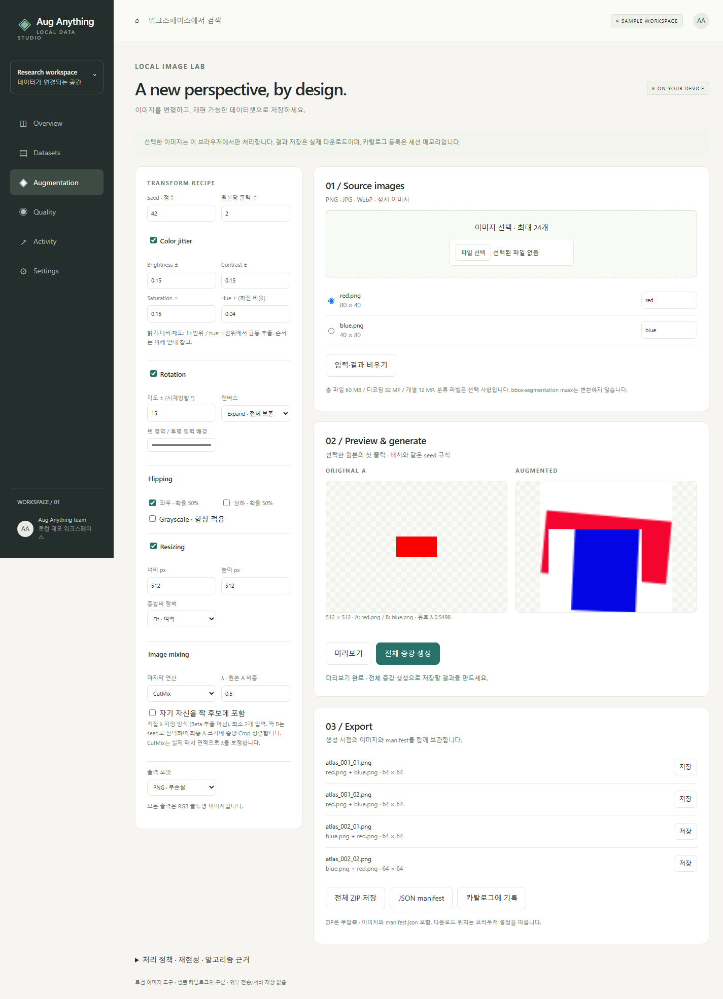

<div align="center">

# ◈ Aug Anything

**A local image lab, inside a thoughtful data workspace.**

Explore datasets. Compose augmentations. Export reproducible image batches.

[Quick start](#quick-start) · [Image lab](#image-lab) · [How it works](#how-it-works) · [Validation](#validation)

**One HTML file · No installation · No cloud uploads**

</div>



## Quick start

1. Download this repository using **Code → Download ZIP**, then extract it.
2. Double-click **`data-management-platform-prototype.html`** in a recent desktop browser.
3. Open **Augmentation**, select your PNG, JPG, or WebP images, and optionally enter classification labels.
4. Adjust the recipe and seed. Choose **미리보기** to preview or **전체 증강 생성** to generate the batch.
5. Save individual images, the JSON manifest, or **전체 ZIP 저장** for everything together.

The interface uses Korean labels with English navigation and algorithm names. No account, server, package installation, or internet connection is required. Reference links only open when clicked.

## Image lab

| Transform | Controls and behavior |
| --- | --- |
| **Color jitter** | Seeded brightness, contrast, saturation, and HSV hue shifts; configurable uniform ranges |
| **Rotation** | Seeded signed angle; expanded canvas or original-size crop; configurable background |
| **Flipping** | Independent horizontal and vertical flips, each with probability 0.5 |
| **Resize** | Keep aspect ratio within bounds, fit with padding, or center crop to exact dimensions |
| **MixUp** | RGB weighted blending: `λA + (1 − λ)B` |
| **CutMix** | Seeded rectangular patch replacement, with label weights corrected for the clipped patch area |
| **Grayscale** | Rec.601 luminance conversion |

Mixing uses a **manually specified λ**, not Beta-distribution sampling. Both sources are transformed independently; source B is then center-cropped to source A's final size. Pair selection is seeded. Self-pairing is excluded unless explicitly enabled, and mixing always requires at least two input images.

### ✦ Export with context

- PNG or JPG (92% encoder quality), individually or in a batch.
- An uncompressed ZIP containing every generated image and `manifest.json`.
- Source names, sizes, optional labels, recipe, per-output seed, sampled transform parameters, partner identity, output dimensions, and CutMix patch coordinates.
- Classification weights when the required source labels are present. Identical labels are merged into weight `1`.
- Generation cancellation with the previous completed batch retained.

## How it works

The standalone file includes all HTML, CSS, JavaScript, and a small original ZIP writer. Canvas performs image processing locally; there are no runtime dependencies, remote fonts, analytics, or backend calls.

The fixed processing order is:

```text
Background composite → Color jitter → Grayscale → Flips
                     → Rotation → Resize → MixUp / CutMix
```

Color jitter uses brightness → contrast → saturation → hue. Contrast is centered around mean image luminance. This is an independent browser implementation informed by the cited definitions, **not a pixel-identical port of torchvision**.

For CutMix, the effective weight is computed after clipping:

```text
λeffective = 1 − patch_width × patch_height / (output_width × output_height)
label     = λeffective × label_A + (1 − λeffective) × label_B
```

Mixing is the final operation, so later resizing or cropping cannot invalidate those weights. The same input order, recipe, seed, and browser reproduce the same result. Different browsers may produce different decoding, interpolation, or color-management results.

## A workspace, with clear boundaries

**The image lab is functional.** It reads images you explicitly select and produces real downloadable files.

**The dataset catalog is a prototype.** Ten fictional datasets demonstrate search, type/status filters, sorting, table/card views, metadata drawers, quality summaries, and activity records. Catalog registration stores session metadata only; it does not archive image files or provide access control.

Downloads persist wherever your browser saves them. Inputs, recipes, generated results, and catalog changes remain in tab memory and reset on reload. Original files are never overwritten or deleted by the application.

## Privacy and practical limits

- Images stay on your device. No image or filename is sent to a server by the application.
- Up to 24 inputs, 60 MiB of selected files, 12 megapixels per decoded image, and 32 megapixels total input pixels.
- Up to 5 outputs per input; output dimensions up to 2048 × 2048 when resizing; maximum intermediate canvas 16 megapixels and encoded batch 160 MiB.
- Large images can still demand significant browser memory; decoding and native canvas operations cannot always be interrupted immediately. Cancellation takes effect at the next processing checkpoint.
- Inputs become opaque RGB using the chosen background. Outputs do not preserve EXIF or ICC metadata. Animated images are treated as a still frame.
- **No bounding-box or segmentation-mask transformation.** Classification weights describe the blend; users remain responsible for label validity and whether each augmentation is appropriate.
- PNG, JPEG, and WebP input only. No training, model inference, cloud storage, authentication, or persistent catalog database.

## Validation

Tested in Microsoft Edge using its DevTools protocol on the actual local HTML file:

- **17 catalog regression checks**: navigation, search, filters, sorting, view toggles, all drawer tabs, Escape, dialog focus, safe registration, session reset, and narrow-screen layout.
- **26 augmentation checks**: file decoding failures, URL cleanup, color and geometry pixel tests, MixUp weights, clipped CutMix area, deterministic seeds, batch cancellation/restart, PNG/JPG decoding, actual browser downloads, ZIP structure, manifest data, and 390 px layout.
- No uncaught runtime exceptions or remote network requests during the augmentation checks.
- Desktop and mobile screenshots visually reviewed. Other browsers and screen readers have not been certified.

### Run the browser checks

Requires Node.js 22+ and a Chromium-based browser started with remote debugging on port `9333`. Use a separate temporary browser profile. The scripts connect only to that local debugging endpoint.

```sh
node tests/catalog.cjs
node tests/augmentation.cjs
```

The tests generate synthetic red/blue image fixtures in memory. Outputs and downloads are written under `tests/` and are ignored by Git. Never expose the debugging port to other machines.

## Repository

```text
data-management-platform-prototype.html   Self-contained application and source
docs/                                    Screenshots and validation results
tests/                                   Dependency-free browser checks
README.md                                Product guide and limitations
```

## References and licensing

- [Torchvision ColorJitter](https://docs.pytorch.org/vision/main/generated/torchvision.transforms.ColorJitter.html) — parameter definitions.
- [Zhang et al., mixup: Beyond Empirical Risk Minimization](https://arxiv.org/abs/1710.09412) — convex combinations of images and labels.
- [Yun et al., CutMix](https://arxiv.org/abs/1905.04899) — region replacement and area-proportional labels.
- [Torchvision CutMix / MixUp guide](https://docs.pytorch.org/vision/main/auto_examples/transforms/plot_cutmix_mixup.html) — classification batch semantics.

No third-party runtime code or font assets are bundled. System fonts are used. The references above do not grant a license to this repository. **No open-source license has been selected for this project.**
